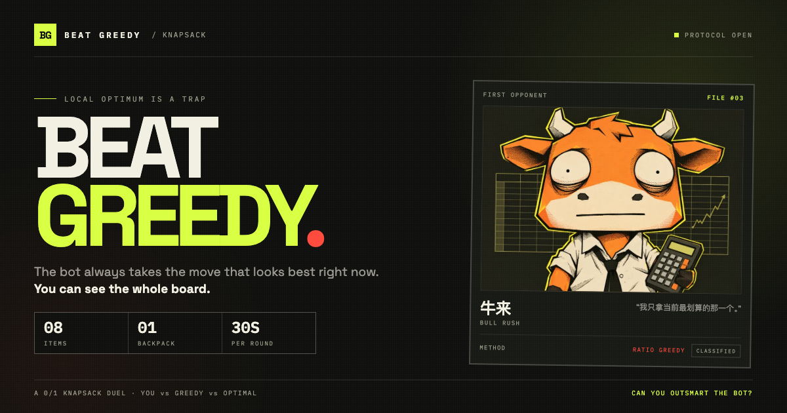

# 贪心小卖部 · BEAT GREEDY

和一个只看眼前的老板比背包。你能把整间店看一遍，他只拿当下最划算的那件。

**局部最优 ≠ 全局最优。**

**[进店应战 →](https://beat-greedy-da-e676.vercel.app/)**



## 怎么玩

每局生成 8 件小卖部商品，各有重量和值，再给你一个背包容量。你要在不超过容量的前提下，装出总价值最高的一包。

- 老板「牛来」先按**性价比贪心**（值 ÷ 重）挑一轮，但选择在你提交前保密。
- 你可以点击商品拿货，再点一次放回；桌面端也可以拖进纸袋背包。
- 提交后揭晓你 / 牛来 / 真正最优解三列，并告诉你差在哪。
- 最优解用 0/1 背包 DP 计算。约五分之一的局里，贪心恰好就是标准答案，这局最多打平。

难度只改时间和陷阱密度：慢慢挑 40 秒、正常逛 30 秒、限时抢 20 秒。

## 评分

```
单局得分 = round(1000 × 你的货值 / 最优货值)
         + 300（击败老板）
         + 剩余秒数 × 5
```

- `S`：正中标准答案
- `A`：赢了老板，且最优率 ≥ 95%
- `B`：赢了老板
- `C`：没赢，但最优率 ≥ 85%
- `D`：其余情况

最高分和声音开关保存在浏览器 `localStorage`，没有登录、没有后端、没有数据库。连续玩时本场总分一直累计。

## 技术栈

- React 19 + TypeScript
- Vite
- Tailwind CSS 4
- dnd-kit（桌面拖拽）
- Vitest（贪心 / DP 对拍 / 计分 / 生成器）

## 本地运行

```bash
npm install
npm run dev
```

```bash
npm test       # 18 个单元测试：DP 对拍、贪心策略、计分边界、生成器约束
npm run lint
npm run build
npm run preview
```

## 部署

纯静态站。Vercel 直接导入仓库即可：

- Build Command: `npm run build`
- Output Directory: `dist`

不需要环境变量。

## 视觉、字体与声音

v1.1 采用「新中式小卖部 + 手账贴纸 + 街机反馈」：米纸底、朱砂 / 玉绿 / 芥末黄、胶带、印章、纸袋、结账单，以及可交互的店员风凉话。

- 标题字体：得意黑（Smiley Sans）v2.0.1 子集，SIL OFL 1.1。子集已按保留字体名要求重命名为 **BG Shop Display**，授权与说明见 `public/fonts/OFL.txt` 和 `public/fonts/NOTICE.md`。
- 音频：WebAudio 现场合成的 D 小调五声音阶循环、木鱼 / 贝斯 / 沙锤与操作音效。没有使用任何外部音频素材。
- 物品图标：24 个手绘 SVG，不使用 emoji。
- 无障碍：按钮可键盘操作、计时器与载重有 ARIA 标签、尊重 `prefers-reduced-motion`。

## 素材与 IP

所有 Boss 立绘都是为这个项目制作的原创致敬形象。研究阶段收集的参考图只在本地使用，不进入发布构建；游戏中不包含官方 logo、官方吉祥物、现有二创角色或真人肖像。公开名使用梗化别名。

## 状态

v1.1 已上线：<https://beat-greedy-da-e676.vercel.app/>。小卖部视觉、中文物品与手绘图标、牛来风凉话、老板点评 / 本局人设、WebAudio、声音开关持久化、结账单、分享文案、新 OG 与中文 meta 均已进生产。当前只开放牛来一个 Boss 与 Knapsack 模式；Boss Rush、每日挑战、其他算法模式留待后续。
